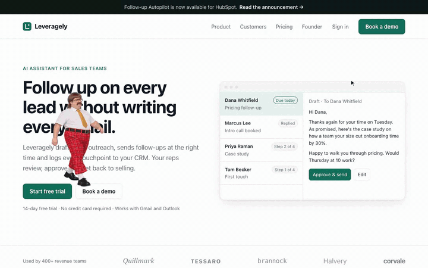
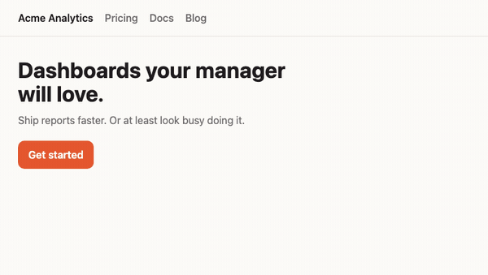

<h1 align="center">gary.js</h1>

<p align="center"><b>A passive-aggressive coworker for your website.</b></p>

<p align="center">
  
</p>

<p align="center">
  <a href="#quick-start">Quick start</a> ·
  <a href="examples/">Examples</a> ·
  <a href="docs/configuration.md">Configuration</a> ·
  <a href="docs/api.md">API</a> ·
  <a href="docs/character-format.md">Make your own character</a>
</p>

---

Gary walks onto your page, stands around unproductively, judges your visitors and offers unsolicited corporate feedback. Visitors can drag him around, mute him or send him home. You decide what he says and when he says it, or swap him for a completely different character on the same engine.

- **One script tag.** No build step, no framework, no backend, no account.
- **Small and polite.** About 26 KB gzipped. Artwork loads only after your page has painted, causes no layout shift, stops entirely in background tabs, and rests when nobody's around.
- **Never in the way.** Clicks pass straight through every transparent pixel. Forms, links and buttons behind him keep working.
- **Visitor-friendly.** Mute or remove him from a menu (mouse, keyboard or touch). Removal sticks. No tracking, no cookies.
- **Yours to script.** Your own lines, page triggers and a small JavaScript API.
- **Bring your own character.** Gary is one character; the engine plays any character you describe in a JSON manifest.

## Quick start

```html
<script defer src="https://cdn.jsdelivr.net/npm/gary.js@0.1.0/dist/gary.js"></script>
```

That's it. Gary walks in once the page has loaded. Pin the version in production.

<details>
<summary>npm / ES modules</summary>

```sh
npm install gary.js
```

```js
import Gary from 'gary.js';

await Gary.init({ character: '/characters/my-character/character.json' });
Gary.say('Hello from the API.');
```

The ES module has no default character and never loads one on its own; pass a manifest URL. To use Gary from npm, self-host `node_modules/gary.js/characters/gary/` and point `character` at its `character.json`.
</details>

## What he does

| Behaviour | What happens |
|---|---|
| `enter` | Walks in from the side of the screen once your page has loaded |
| `walk` | Short, aimless walks along the bottom of the screen, or over headings and images when you let him |
| `idle` | Stands there. Occasionally checks his phone |
| `judge` | A long managerial stare, or a pointed look at whatever you're doing |
| `say` | A speech bubble, placed above his head and kept inside the screen |
| `drag` | Pick him up, he dangles; let go, he falls and gets back up |
| `react-clicks` | Click him three times and he lets you know how he feels about that |
| `leave` | Walks off when a visitor removes him, and stays gone |

He respects `prefers-reduced-motion` (a still pose, no walking or falling) and steps out of the way of a focused form field.

## Ready-made packages

One attribute turns him into a 404 page, a personal-site sidekick, a general nuisance or a staging-server reminder:

```html
<script defer src="https://cdn.jsdelivr.net/npm/gary.js@0.1.0/dist/gary.js" data-preset="404"></script>
```

On a 404 page he walks in from the left, stops on the "404", tells your visitor what went wrong and walks off. Click or scroll while he's there and he has something to say about that too. Presets: `404`, `personal`, `website`, `staging`; anything you configure yourself wins. See [presets](docs/configuration.md#presets).

## Make him say your things

Add a JSON block anywhere in the page:

```html
<script type="application/json" data-gary-config>
{
  "schemaVersion": 1,
  "vars": { "owner": "Sam" },
  "lines": {
    "boast": ["{owner} built this. I supervised. Emotionally."],
    "pricing": ["Pricing? Let's set up a call to discuss a call."]
  },
  "triggers": [
    { "on": "load", "after": 2, "say": "#hello", "once": true },
    { "on": "hover", "selector": "#projects a", "say": "#boast", "cooldown": 30 },
    { "on": "click", "selector": "#contact", "say": "#pricing" },
    { "on": "idle", "after": 30, "say": "Still there? Bold." }
  ]
}
</script>
<script defer src="https://cdn.jsdelivr.net/npm/gary.js@0.1.0/dist/gary.js"></script>
```

`#name` picks a random line from a pool. Triggers: `load`, `idle`, `hover`, `click`, `visible`, `scroll`, `scrolling`, `near`, `exit`, `gary-click`, `time` and your own `event`s, and they can play [scenes](docs/configuration.md#scenes) that walk him onto page elements. Lines are rate-limited (by default at most 2 a minute, 20 seconds apart) so he stays funny instead of exhausting. Full reference: [docs/configuration.md](docs/configuration.md).

## Script him

```js
Gary.say('Per my last email…');      // a line, or '#pool'
Gary.do('judge');                    // walk, idle, judge, say, react-clicks, leave
Gary.emit('deploy');                 // fire your own { "on": "event" } triggers
Gary.on('spoke', (line) => console.log(line));
Gary.mute(); Gary.dismiss(); Gary.destroy();
```

`ready`, `init`, `say`, `do`, `mute`, `unmute`, `dismiss`, `reset`, `emit`, `on` and `destroy` are documented in [docs/api.md](docs/api.md).

## Bring your own character

<p align="center"></p>

The engine knows nothing about Gary. A character is a JSON manifest plus one sprite-atlas image per animation clip:

```html
<script defer src="https://cdn.jsdelivr.net/npm/gary.js@0.1.0/dist/gary.core.js"
        data-character="https://your.site/mugsy/character.json"></script>
```

```json
{
  "schemaVersion": 1,
  "id": "mugsy",
  "name": "Mugsy",
  "licence": "CC0-1.0",
  "assetRevision": "1",
  "display": { "height": 170 },
  "clips": {
    "idle": { "role": "idle", "loop": true, "load": "initial", "size": [150, 200],
              "frameMs": [160, 160, 160, 160],
              "sources": [{ "type": "atlas", "url": "atlas/idle.webp", "grid": { "columns": 4, "rows": 1, "frames": 4 } }] },
    "walk": { "role": "walk.right", "mirror": true, "loop": true, "load": "initial", "size": [150, 200],
              "frameMs": [105, 105, 105, 105],
              "sources": [{ "type": "atlas", "url": "atlas/walk.webp", "grid": { "columns": 4, "rows": 1, "frames": 4 } }] }
  }
}
```

An idle clip is all you need; add walks, a stare, a held pose and a fall when you have them. Missing clips simply switch off the behaviours that need them. `gary.core.js` contains no default character and never requests one. [Mugsy](characters/sample/), the public-domain mug above, is a complete example. The guide: [docs/character-format.md](docs/character-format.md).

## Examples

`npm install && npm run build && npm run serve`, then open <http://127.0.0.1:8700/examples/>:

[404 page](examples/404/) · [personal website](examples/personal/) · [bring your own character](examples/custom-character/) · [any website](examples/website/)

Pages for checking the engine by hand (ES module, host compatibility, page-defined lines) are in [tests/pages/](tests/pages/).

## Browser support, privacy and accessibility

- **Browsers:** current Chrome, Edge, Firefox and Safari (15+), desktop and mobile. Tested in Chromium, Firefox and WebKit, including touch on phone-sized viewports. Where `createImageBitmap` or canvas is unavailable, nothing is shown and the page is unaffected.
- **Privacy:** gary.js sends nothing anywhere. No analytics, beacons, cookies or fingerprinting. It never reads form values, page text or the clipboard. Pointer position and page events are used in the page, in memory, to animate the character. The only network requests are the script and the active character's manifest and images. Mute and removal are stored in `sessionStorage` / `localStorage` on your origin.
- **Security:** lines are inserted as text only, never HTML. No `eval`. Works under a strict CSP: allow the script origin in `script-src` and the character's origin in `connect-src`. See [docs/privacy-and-accessibility.md](docs/privacy-and-accessibility.md).
- **Accessibility:** keyboard-reachable options button (Enter, Shift+F10 or the context-menu key), arrow-key menu, Escape returns focus, long-press on touch, `prefers-reduced-motion` respected, decorative animation hidden from screen readers. Speech bubbles are only announced if you opt in with `"announce": true`.

## Licence

- **Code** (engine, schemas, examples, tooling): [MIT](LICENSE).
- **Gary's artwork and lines** are not MIT. They are distributed under their own licence, included with the artwork in `characters/gary/`.
- **Mugsy**, the sample character: [CC0](characters/sample/LICENSE.md).
- **Your characters** are yours, under whatever licence you choose.

Details: [docs/assets-and-licensing.md](docs/assets-and-licensing.md).

## Contributing

Bug reports, ideas, new triggers and especially new characters are welcome. See [CONTRIBUTING.md](CONTRIBUTING.md). Security issues: [SECURITY.md](SECURITY.md).
