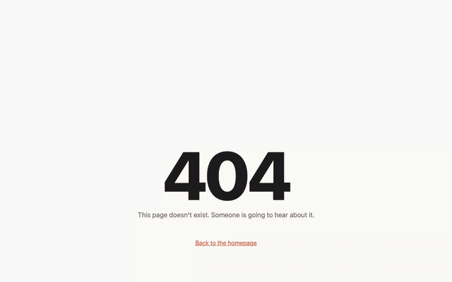
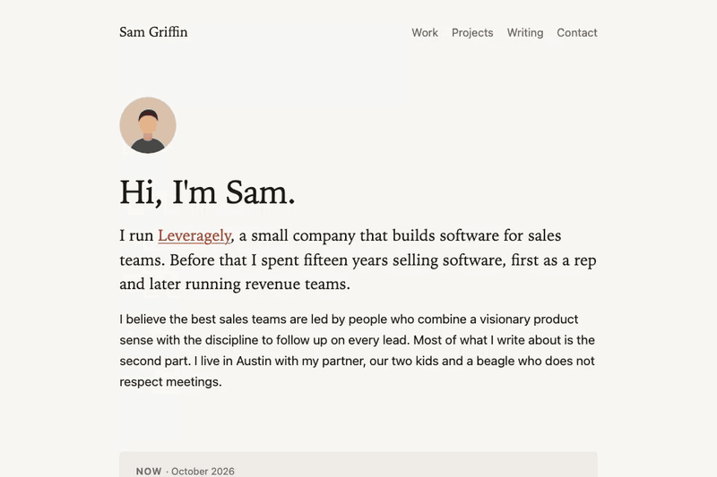
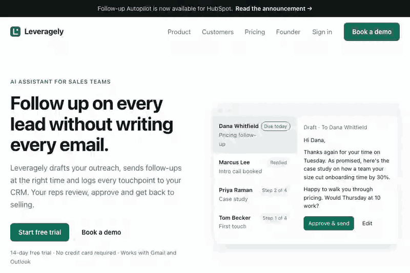

<h1 align="center">gary.js</h1>

<p align="center">
  <strong>Put a passive-aggressive coworker on your website with one script tag.</strong>
</p>

<p align="center">
  Gary walks around your page, judges your visitors, comments on what they're doing,
  and takes credit for things he didn't do.
</p>

<p align="center">
  <a href="https://suchipizza.github.io/DeskMenace/"><strong>Live demo</strong></a> ·
  <a href="#add-gary-in-one-line">Quick start</a> ·
  <a href="#see-gary-at-work">Examples</a> ·
  <a href="#make-him-say-your-things">Customize</a> ·
  <a href="#replace-gary">Bring your own character</a>
</p>

<p align="center">
  
</p>

Your portfolio does not need another gradient.

Your 404 page does not need another sad robot.

**It needs Gary.**

He can be an interactive easter egg, a 404-page menace, a portfolio sidekick, a staging-server
reminder, or the starting point for a completely different character of your own.

No framework. No backend. No account. No tracking.

## Add Gary in one line

```html
<script defer src="https://cdn.jsdelivr.net/npm/gary.js@0.2.0/dist/gary.js"></script>
```

That's it.

Reload the page and Gary walks in.

Want a ready-made 404 version?

```html
<script
  defer
  src="https://cdn.jsdelivr.net/npm/gary.js@0.2.0/dist/gary.js"
  data-preset="404">
</script>
```

Pin the version in production.

---

## Why put this man on your website?

Because websites are allowed to have a personality.

Gary gives you a tiny interactive character without making you build an animation engine, event
system, drag interaction, speech bubbles, accessibility controls, or character runtime yourself.

Use him for:

- **404 pages** — let someone take responsibility for the routing situation.
- **Personal sites** — give your portfolio an unwanted middle manager.
- **Landing pages** — let him comment on pricing, buttons, scrolling, or whatever else deserves feedback.
- **Internal/staging pages** — deploy a reminder that is harder to ignore than another banner.
- **Easter eggs** — make a page people actually send to someone else.
- **Your own character** — keep the engine and replace Gary completely.

Visitors can drag him around, mute him, or send him home.

---

## See Gary at work

### 404 page

[**Open the live 404 demo →**](https://suchipizza.github.io/DeskMenace/examples/404/)

Gary walks onto the 404, assesses the incident, and leaves. Keep clicking and he keeps answering.
(It's the demo at the top.)

### Personal website

[**Open the personal-site demo →**](https://suchipizza.github.io/DeskMenace/examples/personal/)

He inspects the bio, introduces himself with an unnecessarily senior job title, and remains
available for unsolicited feedback.

<p align="center">
  
</p>

### Any website

[**Open the website demo →**](https://suchipizza.github.io/DeskMenace/examples/website/)

Gary reviews a SaaS landing page, objects to being dragged, walks back to work, and develops
opinions about the visitor's scrolling.

<p align="center">
  
</p>

### A completely different character

[**Open the custom-character demo →**](https://suchipizza.github.io/DeskMenace/examples/custom-character/)

Same engine. No Gary.

<p align="center">
  
</p>

---

## What Gary can do

| Behaviour | What happens |
|---|---|
| Walk in | Enters from the edge of the screen after the page loads |
| Wander | Takes short, largely unnecessary walks around the page |
| Stand on things | Can walk onto headings, images, and configured page surfaces |
| Judge | Stops for a long managerial stare |
| Talk | Shows speech bubbles while staying inside the viewport |
| React | Responds to clicks, scrolling, hovering, idling, visibility and custom events |
| Get dragged | Pick him up, move him, drop him; he recovers |
| Check his phone | Remains visibly busy without producing measurable output |
| Leave | Visitors can remove him, and the decision sticks |

Gary respects `prefers-reduced-motion`, stays out of the way of focused form fields, and can be
controlled by mouse, keyboard, and touch.

---

## Ready-made presets

Use one attribute to give Gary a job:

```html
<script
  defer
  src="https://cdn.jsdelivr.net/npm/gary.js@0.2.0/dist/gary.js"
  data-preset="personal">
</script>
```

Current presets:

| Preset | Good for |
|---|---|
| `404` | Error pages |
| `personal` | Portfolios and personal websites |
| `website` | Product and landing pages |
| `staging` | Internal or staging environments |

Your own configuration always wins over preset defaults. On a 404 page he walks in from the left,
stops on the "404", tells your visitor what went wrong and walks off.

See the [configuration reference](docs/configuration.md).

---

## Make him say your things

You decide what Gary says and when he says it.

```html
<script type="application/json" data-gary-config>
{
  "schemaVersion": 1,
  "lines": {
    "pricing": [
      "Pricing? Let's set up a call to discuss a call."
    ],
    "bio": [
      "Strong personal brand. Let's circle back on the personality."
    ]
  },
  "triggers": [
    {
      "on": "click",
      "selector": "#pricing",
      "say": "#pricing"
    },
    {
      "on": "visible",
      "selector": "#about",
      "say": "#bio"
    },
    {
      "on": "idle",
      "after": 30,
      "say": "Still there? Bold."
    }
  ]
}
</script>

<script defer src="https://cdn.jsdelivr.net/npm/gary.js@0.2.0/dist/gary.js"></script>
```

Triggers include:

`load` · `idle` · `hover` · `click` · `visible` · `scroll` · `scrolling` · `near` · `exit` ·
`gary-click` · `time` · custom `event`s

`#name` picks a random line from a pool. Lines are rate-limited (by default at most 2 a minute,
20 seconds apart) so he stays funny instead of exhausting. You can also build
[scenes](docs/configuration.md#scenes) that move the character onto elements, play animations,
speak, wait, and leave.

The full reference is in [docs/configuration.md](docs/configuration.md).

---

## Script him

The small JavaScript API lets the host page intervene directly:

```js
Gary.say('Per my last email…');   // a line, or '#pool'
Gary.do('judge');                 // a behaviour or a scene
Gary.emit('deploy');              // fire your own { "on": "event" } triggers

Gary.on('spoke', (line) => {
  console.log(line);
});

Gary.mute();
Gary.dismiss();
```

Available APIs include `ready`, `init`, `say`, `do`, `mute`, `unmute`, `dismiss`, `reset`,
`emit`, `on`, and `destroy`.

See [docs/api.md](docs/api.md).

---

## Replace Gary

Gary is the default character.

The engine itself is character-agnostic.

A character is a JSON manifest plus sprite-atlas images for the animations you want to support.
You can start with only an idle animation; behaviours that need missing clips simply switch off.

```html
<script
  defer
  src="https://cdn.jsdelivr.net/npm/gary.js@0.2.0/dist/gary.core.js"
  data-character="https://your.site/my-character/character.json">
</script>
```

[Mugsy](characters/sample/), the public-domain coffee mug used in the demo above, is a complete
example character you can copy.

To build your own:

1. Create a character manifest.
2. Add sprite atlases for the animations you want.
3. Choose the character's display size and behaviour roles.
4. Load it through `gary.core.js`.

See [Make your own character](docs/character-format.md).

If you build a good one, contributions are welcome.

---

## Designed to be a good guest

Putting somebody else's JavaScript on your site is a reasonable thing to be suspicious about.

gary.js is deliberately constrained.

- **~26 KB gzipped.**
- **No runtime dependencies.**
- **No backend.**
- **No analytics, cookies, fingerprinting, or telemetry.**
- **No reading form values, page text, or clipboard contents.**
- **No layout shift.**
- **Stops work in background tabs.**
- **Transparent pixels do not block the page underneath.**
- **Visitors can mute or remove the character.**
- **Removal persists on your origin** (`localStorage`; mute lasts the session).
- **`prefers-reduced-motion` is respected.**
- **Speech is inserted as text, never HTML.**
- **No `eval`.**
- **Works under a strict CSP:** allow the script origin in `script-src` and the character's origin in `connect-src`.

The only normal network requests are for the script and the active character's manifest/images.

More detail: [privacy, accessibility and host-page behaviour](docs/privacy-and-accessibility.md).

---

## npm / ES modules

```sh
npm install gary.js
```

```js
import Gary from 'gary.js';

await Gary.init({
  character: '/characters/my-character/character.json'
});

Gary.say('Hello from the API.');
```

The ES module does not load Gary automatically. Pass a character manifest explicitly.

To use Gary from npm, self-host `node_modules/gary.js/characters/gary/` and point `character` at its
`character.json`.

---

## Browser support

Current support:

- Chrome
- Edge
- Firefox
- Safari 15+
- desktop and mobile
- touch input
- keyboard interaction
- reduced-motion environments

The project is tested in Chromium, Firefox, and WebKit.

If a required browser capability (canvas, `createImageBitmap`) is unavailable, the character fails
closed: nothing is shown and the host page keeps working.

**Accessibility:** a keyboard-reachable options button (Enter, Shift+F10 or the context-menu key),
an arrow-key menu, Escape returns focus, long-press on touch, and the decorative animation is hidden
from screen readers. Speech bubbles are announced only if you opt in with `"announce": true`.

---

## Local development

```sh
git clone https://github.com/suchipizza/DeskMenace.git
cd DeskMenace

npm install
npx playwright install chromium firefox webkit

npm run build
npm run serve
```

Then open:

```text
http://127.0.0.1:8700/examples/
```

Useful checks:

```sh
npm run typecheck
npm test
npm run test:browser
npm run budget
npm run audit:private
npm run audit:pack
```

See [CONTRIBUTING.md](CONTRIBUTING.md) for contribution guidelines.

---

## Project principles

gary.js should remain:

- **character-agnostic** — the engine should not need Gary-specific logic;
- **small** — bundle size is checked in CI;
- **dependency-free at runtime**;
- **safe for the host page** — no blocked clicks, hidden tracking, or unexpected content access;
- **accessible** — mouse interactions should have keyboard/touch equivalents where applicable;
- **easy to remove** — the joke stops when the visitor wants it to stop.

---

## Licence

There are deliberately two licensing layers:

- **Engine, schemas, examples, tooling:** MIT — see [LICENSE](LICENSE).
- **Gary's artwork, lines and identity:** [Gary Asset Licence](characters/gary/LICENSE.md). Gary is
  free to use on any website, personal or commercial, through gary.js, and to show in recordings of
  your site; not to modify or reuse outside gary.js. His assets are not MIT-licensed.
- **Mugsy sample character:** [CC0](characters/sample/LICENSE.md).
- **Characters you create:** yours, under the licence you choose.

See [assets and licensing](docs/assets-and-licensing.md) for details.

---

## Contributing

Bug reports, ideas, new triggers, examples, and especially new characters are welcome.

See [CONTRIBUTING.md](CONTRIBUTING.md).

Security issues should be reported privately as described in [SECURITY.md](SECURITY.md).

---

<p align="center">
  <strong>Have you tried leveraging Gary?</strong>
</p>

<p align="center">
  <a href="https://suchipizza.github.io/DeskMenace/">Live demo</a> ·
  <a href="https://github.com/suchipizza/DeskMenace">Star the repo</a> ·
  <a href="https://github.com/suchipizza/DeskMenace/fork">Fork it</a>
</p>
